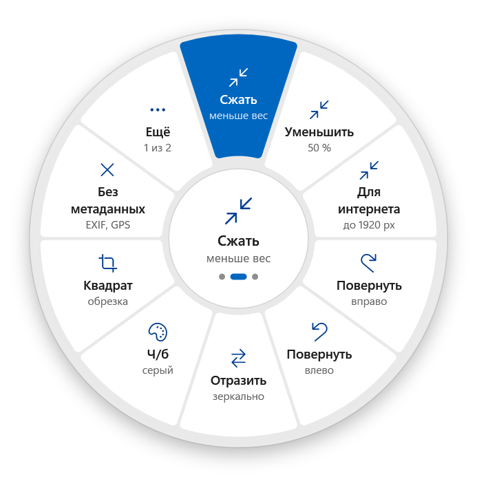
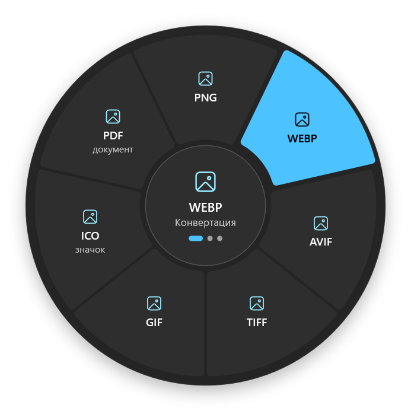
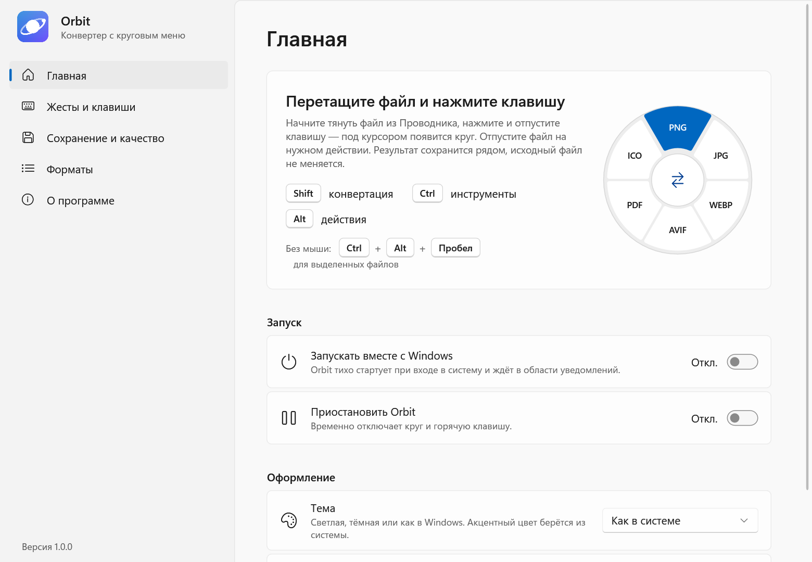
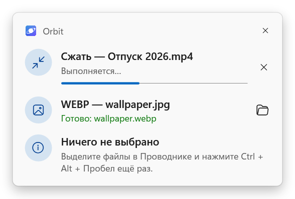
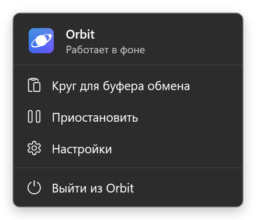

# Orbit

Конвертер файлов с круговым меню для Windows 11. Начните перетаскивать файл с рабочего стола или из Проводника,
нажмите и отпустите **Shift**, **Ctrl** или **Alt** — под курсором появится круг. Отпустите файл на нужном действии.
В других приложениях эти клавиши при перетаскивании работают как обычно — Orbit их не трогает.

<p align="center">
  
  
</p>

## Скачать

| Версия | Для какой Windows |
| --- | --- |
| **[Orbit 1.0.2](https://github.com/kolyaka6969-ops/Orbit/releases/latest/download/Orbit-1.0.2-Setup-x64.exe)** | Windows 11 и Windows 10 с последними обновлениями |
| **[Orbit 1.0.2 для Windows 10 22H2](https://github.com/kolyaka6969-ops/Orbit/releases/latest/download/Orbit-1.0.2-Win10-22H2-Setup-x64.exe)** | Windows 10 22H2 без обновлений — если обычная версия при запуске падает с «Unknown Hard Error» |

[Все релизы](https://github.com/kolyaka6969-ops/Orbit/releases). Только x64, права администратора не нужны.
Версии ставятся друг поверх друга, настройки сохраняются.

Версия для Windows 10 22H2 собрана без защиты стека CET: в Windows 10 без обновлений 2023 года .NET с ней не
запускается ([dotnet/runtime#110000](https://github.com/dotnet/runtime/issues/110000)). Больше она ничем не отличается.

## Как пользоваться

| Клавиша при перетаскивании | Круг | Что внутри |
| --- | --- | --- |
| **Shift** | Конвертация | PNG, JPG, WEBP, AVIF, TIFF, GIF, ICO, PDF · MP3, M4A, WAV, FLAC, WMA · MP4, WMV · PDF → картинки · распаковка архивов |
| **Ctrl** | Инструменты | сжать, уменьшить, «для интернета», повернуть, отразить, ч/б, квадрат, без метаданных, распознать текст, объединить в PDF, разделить PDF, видео 720p и без звука, ZIP, SHA-256 |
| **Alt** | Действия | копировать путь, в буфер обмена, на рабочий стол, переместить, копия, в корзину |

Без мыши: выделите файлы в Проводнике и нажмите **Ctrl + Alt + Пробел**. Ещё есть пункт «Открыть в Orbit»
в контекстном меню Проводника и круг для содержимого буфера обмена (в том числе снимков Win+Shift+S).

Исходные файлы не перезаписываются — результат сохраняется рядом (или в подпапку / выбранную папку).
Всё работает локально и без интернета: изображения — встроенный ImageMagick, аудио и видео — кодеки Windows
(Media Foundation), PDF — движок Windows и PDFsharp, распознавание текста — Windows OCR.

## Оформление под Windows 11

- окно настроек с фоном **Mica**, навигацией слева и карточками, как в «Параметрах» Windows;
- светлая и тёмная тема (или как в системе) с переключением на лету, **системный акцентный цвет**;
- шрифты Segoe UI Variable и значки Segoe Fluent Icons, скруглённые углы, переключатели и списки в стиле WinUI 3;
- меню значка в трее и панель задач с прогрессом — в стиле всплывающих окон Windows 11.

<p align="center">
  
</p>
<p align="center">
  
  
</p>

## Автозапуск

- В установщике есть галочка **«Запускать Orbit при входе в Windows»** (включена по умолчанию).
- В программе: **Настройки → Главная → Запускать вместе с Windows**.

Используется обычный ключ `HKCU\Software\Microsoft\Windows\CurrentVersion\Run`, поэтому Orbit виден и
управляется в «Диспетчере задач → Автозагрузка». Если отключить его там, переключатель в настройках это покажет.
При автозапуске Orbit стартует тихо — только значок в области уведомлений.

## Установка

Запустите `Orbit-1.0.2-Setup-x64.exe` (или `Orbit-1.0.2-Win10-22H2-Setup-x64.exe` для Windows 10 22H2 без обновлений). Права администратора не нужны: программа ставится для текущего пользователя
в `%LOCALAPPDATA%\Programs\Orbit`, добавляется в меню «Пуск» и удаляется через «Параметры → Приложения».
Внутри уже есть всё нужное (.NET, ImageMagick), отдельно ничего ставить не надо. Нужна Windows 10 1809+ или Windows 11, x64.

При удалении убираются автозапуск и пункт контекстного меню. Настройки остаются в `%APPDATA%\Orbit`.

## Сборка

Нужен [.NET SDK 10](https://dotnet.microsoft.com/download) и для установщика — [Inno Setup 6.5+](https://jrsoftware.org/isdl.php).

```powershell
./build.ps1
```

Результат: `publish/` и `publish-win10/` (папки программы, обычная и для Windows 10 22H2),
`artifacts/Orbit-1.0.2-Setup-x64.exe` и `artifacts/Orbit-1.0.2-Win10-22H2-Setup-x64.exe` (установщики), `artifacts/SHA256SUMS.txt`.
Ключ `-NoInstaller` собирает только программу, `-Version 1.2.0` меняет номер версии.

Проверка всех операций на тестовых файлах (картинки, голос и ролик берутся из самой Windows):

```powershell
./scripts/smoke-test.ps1 -Exe publish/Orbit.exe -WorkDir $env:TEMP/orbit-test
```

Режимы командной строки для диагностики: `Orbit.exe --list файлы…` (какие пункты доступны),
`--run id файлы…` (выполнить пункт), `--probe видео` (что видит Media Foundation),
`--render папка файл` (нарисовать окна в PNG без показа на экране).

## Устройство

```
src/Orbit/
  App.xaml(.cs)        запуск, одна копия, трей, аргументы (--autostart, --exit, --unregister, пути файлов)
  Core/                модель операций, каталог пунктов, форматы, настройки, имена результатов
  Core/Backends/       ImageMagick, Media Foundation, PDF, архивы, OCR
  Shell/               глобальные хуки, горячая клавиша, автозапуск, Проводник, трей, миниатюры
  UI/                  круговое меню, настройки, панель задач, меню трея, тема и Mica
  Themes/              цвета светлой/тёмной темы (токены WinUI 3) и стили контролов
installer/Orbit.iss    установщик Inno Setup (галочки автозапуска и контекстного меню)
```

## Авторы

- [@kolyaka6969-ops](https://github.com/kolyaka6969-ops)
- [@weightlu](https://github.com/weightlu)

Идея кругового меню при перетаскивании — из проекта [Sweetch](https://github.com/krllmrzv/Sweetch) (MIT);
код Orbit написан заново. См. `LICENSE` и `THIRD-PARTY-NOTICES.md`.
